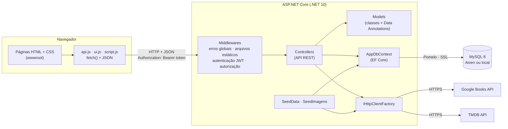
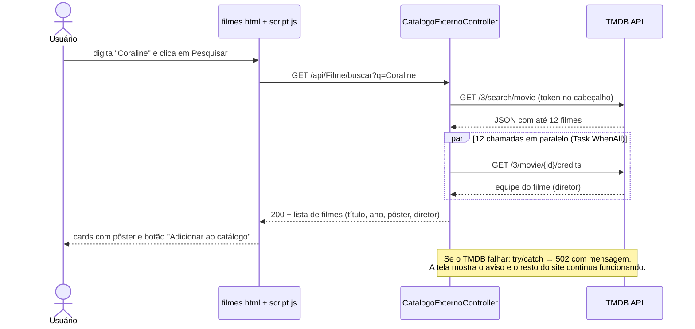
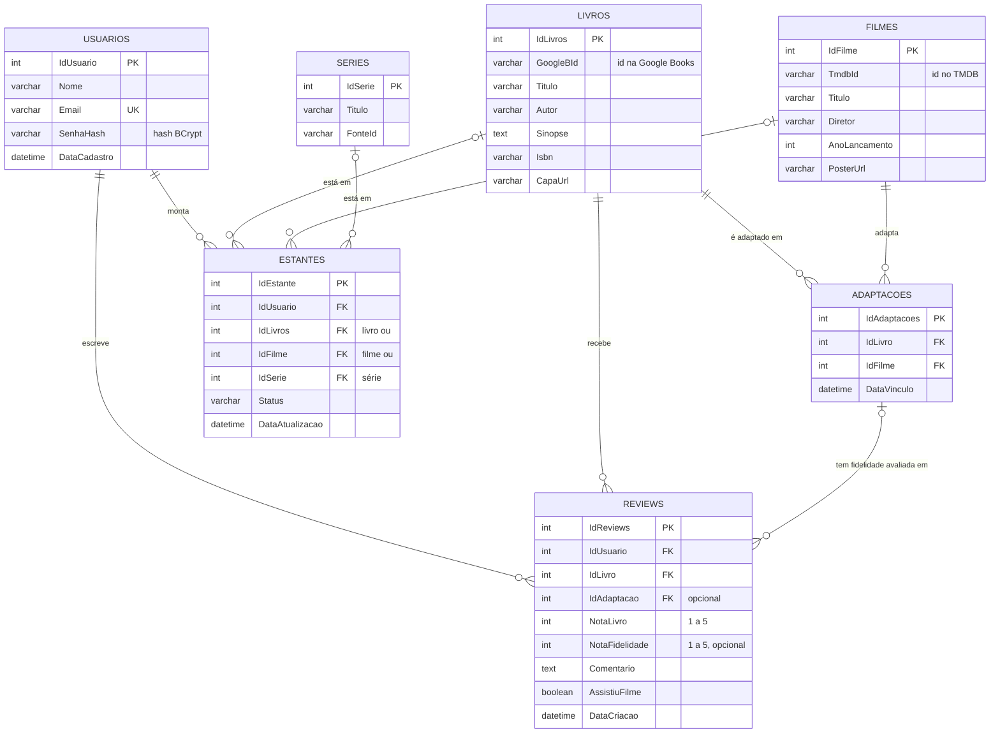

# Resenhário: documentação técnica

> Base para o PDF final da disciplina **Desenvolvimento de Software Visual** (Universidade Positivo, 2026).
> Para instalar e rodar, veja o [`LEIA-ME.md`](../LEIA-ME.md). Para a apresentação, o [`ROTEIRO_DEMO.md`](ROTEIRO_DEMO.md).

## 1. Visão geral

O **Resenhário** é uma plataforma web de catálogo literário social que liga livros às suas adaptações para o cinema. A ideia central é transformar o interesse por um filme em porta de entrada para a leitura: *o filme acabou, a história continua no livro*.

O usuário pode:

- criar conta e entrar com segurança (senha com **BCrypt**, sessão com token **JWT**);
- buscar livros na **Google Books API** e filmes na **TMDB API** e salvá-los no catálogo;
- **vincular** um livro às suas adaptações (um livro pode ter várias, como *Duna* de 1984 e de 2021);
- organizar a **estante virtual** com os status *Quero ler*, *Lendo*, *Lido* e *Abandonado*;
- publicar **resenhas com avaliação dupla**: nota da obra (1 a 5) e, se viu o filme, nota de **fidelidade** da adaptação (1 a 5);
- acompanhar o **feed** da comunidade, com comparativo entre a nota de cada leitor e a média da comunidade;
- ver o **ranking** das adaptações mais fiéis (pódio) e as **estatísticas de leitura** em gráficos.

**Fora do escopo** (definido no documento de escopo): leitor de e-books, streaming de vídeo, venda de livros ou ingressos e aplicativo mobile nativo.

### Tecnologias

| Camada | Tecnologia |
|---|---|
| Linguagem / framework | C# 14, **.NET 10**, ASP.NET Core Web API (controllers) |
| Acesso a dados | **Entity Framework Core 9** + **Pomelo.EntityFrameworkCore.MySql** |
| Banco | **MySQL 8**: na nuvem (**Aiven**) ou local |
| Front-end | HTML, CSS e JavaScript puro em `wwwroot/`, consumindo a API com `fetch()` |
| APIs externas | Google Books API, TMDB API (via `IHttpClientFactory`) |
| Segurança | BCrypt.Net-Next, JWT Bearer, `[Authorize]`, `dotnet user-secrets` |
| Documentação da API | OpenAPI + **Swagger UI** (`/swagger`) |
| Gráficos | Chart.js 4.4.1 (CDN, com cópia local em `wwwroot/lib`) |

> **Por que EF Core 9 num projeto .NET 10?** O provedor de MySQL que usamos (Pomelo) ainda não tem versão para o EF Core 10. O EF Core 9 roda normalmente no .NET 10.

---

## 2. Arquitetura

O projeto é **uma única aplicação ASP.NET Core** que faz duas coisas: serve as páginas do site (arquivos estáticos em `wwwroot/`) e expõe a **API REST** em `/api/...`. O JavaScript das páginas chama a API com `fetch()` e troca dados em **JSON**.



### Como o padrão MVC aparece no projeto

| Parte | Onde está | Papel |
|---|---|---|
| **Model** | `Models/` (`Livro`, `Filme`, `Adaptacao`, `Review`, `Estante`, `Usuario`) e `Models/Externos/` (DTOs das APIs externas) | Dados e regras: Data Annotations e regras do domínio (ex.: `Estante.StatusValido`) |
| **Controller** | `Controllers/` | Recebe a requisição, valida, usa o `AppDbContext` ou as APIs externas e devolve JSON com o status HTTP correto |
| **View** | `wwwroot/` (`index.html`, `paginas/*.html`, `css/`, `js/`) | Interface. Em vez de Razor (`.cshtml`), usamos HTML estático + JavaScript que chama a API com `fetch()` (alternativa vista em aula) |

### Organização das pastas

```
BACKEND/Resenhario.Api/
├── Controllers/        AuthController, LivroController, FilmeController, AdaptacaoController,
│                       EstanteController, ReviewController, UsuarioController,
│                       CatalogoExternoController (APIs externas), SerieController (extra)
├── Models/             Classes do domínio + Data Annotations
│   └── Externos/       DTOs da Google Books API e da TMDB API
├── Data/               AppDbContext, SeedData (dados de demonstração), SeedImagens (capas e pôsteres)
├── wwwroot/            Front-end: index.html, paginas/, css/style.css, js/, lib/chart.umd.min.js
├── Program.cs          Serviços, middlewares, rotas, seed e /api/saude
├── appsettings.json    Configurações sem segredos (segredos ficam em user-secrets)
└── Resenhario.Api.http Exemplos de requisições para testar a API
BANCO DE DADOS/         Scripts SQL de criação e atualização (não destrutivos)
```

### Fluxo de uma requisição (exemplo: buscar um filme)



---

## 3. Modelo de dados (MER)

As tabelas são criadas pelos scripts `BANCO DE DADOS/01`, `05`, `08` e `09`. As seis tabelas previstas no escopo estão presentes: **Usuarios, Livros, Filmes, Adaptacoes, Reviews e Estante** (no banco, `Estantes`). `Series` é um extra, fora do escopo e escondido do menu.



**Regras importantes**

- **Adaptacoes** é a tabela de ligação (muitos-para-muitos) entre Livros e Filmes. O índice único `UQ_Adaptacoes_Livro_Filme` impede o mesmo vínculo duas vezes.
- **Reviews** guarda a **avaliação dupla**: `NotaLivro` é obrigatória; `NotaFidelidade` e `IdAdaptacao` só são preenchidas se a pessoa viu uma adaptação **daquele livro** (regra conferida no `ReviewController`).
- **Estantes** guarda um item por linha (livro, filme ou série). Os status válidos ficam no Model `Estante`: livro aceita *Quero ler / Lendo / Lido / Abandonado*; filme aceita *Quero ver / Assistindo / Assistido*.
- **Usuarios.Email** tem índice único (`UQ_Usuarios_Email`).
- As médias **não são guardadas**: são calculadas na hora com `Average()` do EF Core (vira `AVG()` no SQL), então estão sempre atualizadas.

---

## 4. API REST: endpoints

Todas as rotas começam em `http://localhost:5131`. 🔒 = exige token JWT (`Authorization: Bearer <token>`). Sem token, as rotas 🔒 respondem **401**. Erros de validação (Data Annotations) respondem **400** com as mensagens de cada campo. Exemplos prontos estão em `Resenhario.Api.http` e no Swagger (`/swagger`).

### Autenticação e usuário

| Verbo | Rota | Descrição | Respostas |
|---|---|---|---|
| POST | `/api/Auth/cadastro` | Cria conta (senha com BCrypt) e devolve o token | **201**, 400, 409 (e-mail já existe) |
| POST | `/api/Auth/login` | Confere a senha e devolve o token JWT (8 h) | **200**, 400, 401 |
| GET 🔒 | `/api/Usuario/me` | Dados do usuário logado | **200**, 401, 404 |

### Livros

| Verbo | Rota | Descrição | Respostas |
|---|---|---|---|
| GET | `/api/Livro` | Catálogo em ordem alfabética | **200** |
| GET | `/api/Livro/{id}` | Um livro | **200**, 404 |
| GET | `/api/Livro/{id}/medias` | Média da nota do livro e fidelidade de cada adaptação | **200**, 404 |
| GET | `/api/Livro/buscar?q=` | Busca na **Google Books API** | **200**, 400, 502, 504 |
| POST 🔒 | `/api/Livro` | Adiciona ao catálogo | **201**, 400, 409 (já existe) |
| PUT 🔒 | `/api/Livro/{id}` | Atualiza | **204**, 400, 404 |
| DELETE 🔒 | `/api/Livro/{id}` | Remove | **204**, 404, 409 (tem vínculos) |

### Filmes

| Verbo | Rota | Descrição | Respostas |
|---|---|---|---|
| GET | `/api/Filme` | Catálogo de filmes | **200** |
| GET | `/api/Filme/{id}` | Um filme | **200**, 404 |
| GET | `/api/Filme/buscar?q=` | Busca na **TMDB API** (pôster e diretor) | **200**, 400, 502, 503 (sem token), 504 |
| POST 🔒 | `/api/Filme` | Adiciona ao catálogo (se já existir, devolve o existente) | **201**, 200, 400 |

### Adaptações (Livro ↔ Filme)

| Verbo | Rota | Descrição | Respostas |
|---|---|---|---|
| GET | `/api/Adaptacao` | Todas as adaptações com capa, pôster e médias | **200** |
| GET | `/api/Adaptacao/{id}` | Um vínculo | **200**, 404 |
| GET | `/api/Adaptacao/ranking` | Top 20 por fidelidade média (mínimo de 2 avaliações; desempate pela nota do livro) | **200** |
| POST 🔒 | `/api/Adaptacao` | Vincula livro e filme | **201**, 400, 409 (já vinculado) |
| DELETE 🔒 | `/api/Adaptacao/{id}` | Remove o vínculo | **204**, 404, 409 (tem resenhas) |

### Estante virtual (todas 🔒)

| Verbo | Rota | Descrição | Respostas |
|---|---|---|---|
| GET 🔒 | `/api/Estante` | Itens do usuário logado (com título e imagem) | **200** |
| GET 🔒 | `/api/Estante/{id}` | Um item (só do próprio usuário) | **200**, 404 |
| POST 🔒 | `/api/Estante` | Adiciona livro ou filme | **201**, 400, 409 (já está na estante) |
| PUT 🔒 | `/api/Estante/{id}` | Muda o status | **204**, 400, 404 |
| DELETE 🔒 | `/api/Estante/{id}` | Remove da estante | **204**, 404 |

### Resenhas e feed

| Verbo | Rota | Descrição | Respostas |
|---|---|---|---|
| GET | `/api/Review/feed?pagina=1&tamanho=10` | Feed paginado, com capa, pôster e média da comunidade | **200** |
| GET | `/api/Review` | Últimas 100 resenhas | **200** |
| GET | `/api/Review/{id}` | Uma resenha | **200**, 404 |
| POST 🔒 | `/api/Review` | Publica resenha com avaliação dupla | **201**, 400 |
| DELETE 🔒 | `/api/Review/{id}` | Remove a própria resenha | **204**, 404 |

### Utilitários e extras

| Verbo | Rota | Descrição | Respostas |
|---|---|---|---|
| GET | `/api/saude` | Minimal API: API e banco conectados? | **200**, 503 |
| GET | `/swagger` | Interface do Swagger (ambiente Development) | 200 |
| GET / POST 🔒 | `/api/Serie`, `/api/Serie/{id}`, `/api/Serie/buscar` | Séries via TVmaze (extra, fora do escopo) | 200, 201, 404 |

**Por que esses status?** `201 Created` quando um recurso novo é criado (com o cabeçalho `Location` apontando para ele); `204 No Content` quando a alteração deu certo e não há nada novo para devolver (PUT e DELETE); `400` para dado inválido; `401` sem login; `404` quando não existe ou não é seu; `409 Conflict` quando a ação conflita com o estado atual (duplicado ou com vínculos); `502/504` quando a **API externa** falhou ou demorou; `503` quando um serviço necessário não está disponível (token do TMDB ausente, banco fora do ar).

---

## 5. Integração com APIs externas

As chamadas ficam no `CatalogoExternoController`: o navegador chama a **nossa** API, e ela chama a API externa. Assim as chaves nunca chegam ao JavaScript.

| | Google Books API | TMDB API |
|---|---|---|
| Para quê | Buscar livros e capas | Buscar filmes, pôsteres e diretores |
| Endereço | `googleapis.com/books/v1/volumes?q=` | `api.themoviedb.org/3/search/movie` e `/3/movie/{id}/credits` |
| Credencial | `GoogleBooks:ApiKey` (opcional, evita a cota pública) | `Tmdb:ReadAccessToken` (obrigatório), no cabeçalho `Authorization: Bearer` |
| DTOs | `Models/Externos/GoogleBooksDtos.cs` | `Models/Externos/TmdbDtos.cs` |

**Como funciona (padrão visto em aula):**

1. **`IHttpClientFactory`** (registrado no `Program.cs` com o nome `"CatalogoExterno"`, timeout de 20 s): reaproveita conexões em vez de criar `new HttpClient()` a cada chamada.
2. **`GetAsync` / `SendAsync` + `await`**: a chamada não trava o servidor enquanto espera a resposta.
3. **Desserialização com `System.Text.Json`**: `ReadFromJsonAsync<GoogleBooksResposta>()` transforma o JSON em DTOs (*records* só com os campos usados). No TMDB, `[JsonPropertyName("poster_path")]` liga o nome com sublinhado à propriedade `PosterPath`.
4. **`try/catch`**: `HttpRequestException` (sem conexão) e `JsonException` (resposta inválida) viram **502** com mensagem; timeout vira **504**. A tela mostra um aviso amigável e o resto do site continua funcionando.
5. **Desempenho:** os diretores dos 12 filmes são buscados em paralelo com `Task.WhenAll`. Num teste com um TMDB simulado (0,5 s por chamada), a busca caiu de 6,2 s para 0,7 s.

**Dados de demonstração.** `SeedData` cria 20 livros, 21 filmes, 21 adaptações, 6 usuários, 32 resenhas e 47 itens de estante. É **idempotente**: verifica se cada registro existe antes de inserir. `SeedImagens` usa as mesmas APIs e DTOs para buscar capas e pôsteres que estejam faltando e **salva no banco**, de modo que a apresentação não depende das APIs ao vivo.

---

## 6. Segurança

| Tema | Como foi feito | Onde |
|---|---|---|
| Senhas | `BCrypt.HashPassword` no cadastro e `BCrypt.Verify` no login. Só o hash (ex.: `$2a$11$...`) vai para o banco | `AuthController` |
| Sessão | Token **JWT** assinado (HMAC-SHA256), validade de 8 h, com o ID do usuário dentro (claim) | `AuthController.CriarResposta`, `Program.cs` |
| Rotas protegidas | `[Authorize]` na estante, nas resenhas e em toda escrita do catálogo | Controllers |
| Dono do dado | O ID do usuário vem **do token**, nunca do corpo da requisição: ninguém altera a estante ou apaga a resenha de outra pessoa trocando um ID | `EstanteController`, `ReviewController` |
| Login | Mensagem genérica "E-mail ou senha incorretos" (não revela se o e-mail existe) | `AuthController` |
| Validação | Data Annotations (`[Required]`, `[StringLength]`, `[Range(1,5)]`, `[EmailAddress]`, `[MinLength(8)]`) + regras no controller | `Models/`, `AuthController` |
| Erros | `UseExceptionHandler`: erro inesperado vira 500 em JSON, sem stack trace para o navegador | `Program.cs` |
| Segredos | String de conexão, token do TMDB e chave do Google em **`dotnet user-secrets`**, fora do Git. O histórico do repositório foi verificado: nenhum segredo commitado | `appsettings.Example.json`, `LEIA-ME.md` |
| Banco na nuvem | Conexão com `SslMode=Required` (o Aiven exige SSL) | user-secrets |
| Front | Textos do usuário inseridos com `textContent` (nunca `innerHTML`), o que evita injeção de HTML/JS (XSS) | `wwwroot/js/ui.js` |

**Limitação conhecida (aceitável no projeto acadêmico):** o token fica no `localStorage`. Em produção, o ideal seria um cookie `HttpOnly`.

---

## 7. Front-end

- **Sem framework:** HTML, CSS e JavaScript puro, organizados em três arquivos JS: `api.js` (todas as chamadas `fetch` e a sessão), `ui.js` (componentes visuais reutilizáveis: card de obra, card **Livro vs. Filme**, estrelas, avisos, skeleton, estados vazios) e `script.js` (lógica de cada página).
- **Identidade visual "cinema + livro":** tema escuro com destaque âmbar, títulos em Fraunces e texto em Inter (Google Fonts), layout responsivo testado em 390 px (celular) e 1280 px.
- **Resiliência:** placeholder desenhado quando falta imagem, mensagens amigáveis quando a API falha e Chart.js com cópia local para funcionar sem internet.

---

## 8. Como rodar

Resumo (detalhes no [`LEIA-ME.md`](../LEIA-ME.md)):

1. Criar o banco (Aiven ou local) com os scripts `01`, `05`, `08` e `09`.
2. Gravar os segredos com `dotnet user-secrets set` (conexão, token do TMDB, chave do Google).
3. `cd BACKEND/Resenhario.Api` e `dotnet run --launch-profile http`.
4. Abrir `http://localhost:5131` (site), `/swagger` (API) e `/api/saude` (conexão com o banco).

---

## 9. Testes realizados

| Teste | Como | Resultado |
|---|---|---|
| Build | `dotnet build` após cada alteração | 0 erros, 0 avisos |
| Rotas da API | Chamadas reais contra um MySQL 8 de teste: todas as requisições do `Resenhario.Api.http` e os principais casos de erro (400, 401, 404, 409) | Status conforme a tabela da seção 4 |
| Fluxo completo na interface | Navegador automatizado (Playwright): login, estante, vínculo, resenha, feed, ranking, estatísticas | Sem erros de JavaScript |
| Responsividade | Todas as páginas em 390 px e 1280 px | Sem rolagem horizontal |
| Falhas | Banco desligado de propósito; CDN bloqueado; APIs externas simuladas com erro 500 e JSON inválido | Mensagens amigáveis; nenhuma tela quebra |
| Seed | API reiniciada várias vezes | Nenhum registro duplicado |
| Compatibilidade com o Aiven | Conexão com `SslMode=Required` e scripts com `sql_require_primary_key=ON` | OK |
